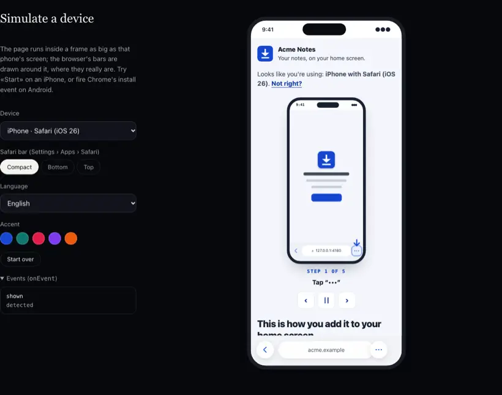

<h1 align="center">pwa-install-assistant</h1>

<p align="center"><strong>Lleva tu web app a la pantalla de inicio. En cualquier móvil.</strong></p>

<p align="center">
  <a href="https://mauroz9.github.io/pwa-install-assistant/"></a>
</p>

<p align="center">
  <a href="https://mauroz9.github.io/pwa-install-assistant/"></a>
</p>

<p align="center">Simula un iPhone, un iPad o un Android, o ábrela en el tuyo: <em>la demo se instala de verdad.</em><br><sub><a href="./README.md">English</a> · <a href="#instalación">Instalación</a> · <a href="#uso">React · Vue · Svelte · Solid · Angular · HTML</a> · <a href="./docs/options.md">Opciones</a> · <a href="./docs/support.md">Tabla de soporte</a></sub></p>

Un asistente de instalación para web apps. Averigua qué móvil, navegador y versión usa cada persona y la guía para
añadir tu app a la pantalla de inicio **con los botones reales del navegador**: una flecha sobre el botón Compartir o
`•••` de Safari, el diálogo de instalación propio de Chrome lanzado desde un botón de tu página, o una guía ilustrada
para todo lo demás.

- **Cualquier dispositivo.** iPhone e iPad (iOS 15 a 26, iPadOS que se presenta como Mac), Android con Chrome, Samsung
  Internet, Edge, Firefox, Opera, Brave y navegadores de fabricante, navegadores integrados (Instagram, Facebook,
  TikTok, WhatsApp, Gmail…), ordenador (código QR) y «ya instalada». Probado con 67 User-Agents reales.
- **Una flecha sobre el botón de verdad.** En Safari sabe dónde está Compartir o `•••` según dispositivo, versión,
  orientación y diseño de la barra, medido en el simulador de iOS.
- **Avanza solo donde se puede.** En Chrome para Android pasa de tu botón al diálogo nativo y a «¡Instalada!» sin un
  solo «Siguiente», permite reintentar si se cancela y avisa de la confirmación del lanzador. Donde el navegador no
  avisa de nada (Safari), lo dice y enseña todos los pasos a la vez.
- **Nada inventado.** Cada flujo asistido solo está activado donde se ha verificado en simulador, emulador o
  dispositivo ([tabla de soporte](./docs/support.md)); el resto usa la guía.
- **Cualquier stack.** Un núcleo sin framework y envoltorios finos para **React** (y Next.js), **Vue**, **Svelte**,
  **Solid**, **Angular** y un **Web Component**. Un estado *headless* para pintar tu propia interfaz.
- **Privado y compatible con CSP estricta.** Cero dependencias, cero llamadas de red, sin `innerHTML` ni estilos en
  línea: un único `<style>` con tu `nonce`. El QR se genera en local.
- **Accesible.** WCAG 2.2 AA: cada instrucción está en texto (la flecha es un apoyo), el foco se mueve y se anuncia en
  cada paso, botones de verdad y respeto a `prefers-reduced-motion`. Seis idiomas.

## Instalación

```bash
npm i pwa-install-assistant
```

## Uso

### JavaScript / TypeScript

```ts
import { createInstallAssistant } from "pwa-install-assistant";

const asistente = createInstallAssistant(document.querySelector("#instalar"), {
  appName: "PlanABC",
  icon: "/icons/icon-192.png",
  locale: "es",
  onEvent: (evento) => analitica(evento.type), // la librería no envía nada
});

asistente.destroy();
```

O como hoja inferior que se abre sola tras el primer toque, una sola vez:

```ts
const hoja = createInstallAssistant(null, { appName: "PlanABC", mode: "sheet", trigger: "gesture" });
botonInstalar.onclick = () => hoja.open();
```

> Chrome puede lanzar `beforeinstallprompt` antes de que exista tu interfaz. La librería empieza a escuchar en cuanto
> se importa; si cargas el asistente más tarde, importa `captureInstallPrompt` de `pwa-install-assistant/headless` en
> tu punto de entrada y llámalo.

### React / Next.js

```tsx
import { InstallAssistant } from "pwa-install-assistant/react";

export function Instalar() {
  return <InstallAssistant appName="PlanABC" icon="/icons/icon-192.png" locale="es" />;
}
```

La entrada de React es un componente de cliente (`"use client"` incluido): se puede pintar directamente desde un
componente de servidor de Next.js. Con CSP estricta, pasa el nonce de la petición: `<InstallAssistant nonce={nonce} />`
(ver [`examples/next`](./examples/next), que pone la política en `proxy.ts`). `ref.current.open()` abre un modal o una
hoja. `useInstallState()` da el estado *headless* (`null` en el servidor).

### Vue 3 / Nuxt

```vue
<script setup>
import { InstallAssistant } from "pwa-install-assistant/vue";
</script>

<template>
  <InstallAssistant app-name="PlanABC" locale="es" @event="(e) => registrar(e.type)" />
</template>
```

### Svelte 4 / 5, SvelteKit

```svelte
<script>
  import { installAssistant } from "pwa-install-assistant/svelte";
</script>

<div use:installAssistant={{ appName: "PlanABC", locale: "es" }}></div>
```

### Solid

```tsx
import { installAssistant } from "pwa-install-assistant/solid";

<div use:installAssistant={{ appName: "PlanABC", locale: "es" }} />;
```

### Angular

El *custom element* (con `CUSTOM_ELEMENTS_SCHEMA`) o el envoltorio *standalone* tipado de
[`examples/angular/src/app/install-assistant.component.ts`](./examples/angular/src/app/install-assistant.component.ts).

### Web Component (HTML, Astro, Rails, WordPress…)

```html
<pwa-install-assistant app-name="PlanABC" icon="/icons/icon-192.png" locale="es"></pwa-install-assistant>

<script type="module">
  import "https://esm.sh/pwa-install-assistant/element";
  document.addEventListener("pwa-install", (e) => console.log(e.detail.type));
</script>
```

Hay una app funcionando para cada caso en [`examples/`](./examples): Next, Nuxt, SvelteKit, Astro, Remix (React
Router), Solid, Angular y HTML plano.

## Qué ve cada persona

| Situación | Qué recibe |
|---|---|
| **Chrome en Android** | La guía del menú; cuando Chrome lanza `beforeinstallprompt` (en la primera visita, tras interactuar y ~30–50 s), aparece encima un asistente de cuatro pasos: tu botón → el diálogo de Chrome → «Instalando…» (con el aviso de la confirmación del lanzador) → «¡Instalada!» + «Abrir». Cancelar → paso 1 → «Intentarlo otra vez». Instalar desde el menú de Chrome también llega a «¡Instalada!». |
| **Safari en iPhone/iPad (iOS 26)** | Una animación en bucle con la secuencia completa; una pregunta sobre el diseño de la barra de Safari (solo iPhone, con dibujos, recordada); y **«Empezar»**: una flecha en el borde de la página que señala el botón real `•••` o Compartir, y una pista fija arriba con los pasos siguientes, legible por encima de la hoja de Compartir. |
| **Edge, Samsung Internet, Opera, Brave** | La guía ilustrada; y si el navegador lanza `beforeinstallprompt`, un botón de instalar sencillo. |
| **Safari ≤ 18, Chrome/Edge/Firefox en iOS, Firefox y navegadores de fabricante en Android** | La guía paso a paso ilustrada de ese navegador, con consejos «No veo esta opción». |
| **Instagram, Facebook, TikTok, WhatsApp, Gmail… (navegadores integrados)** | «Abrir en Safari/Chrome» (`x-safari-https://` / intent de Android), «Copiar enlace» y los pasos del menú. |
| **iOS < 16.4 fuera de Safari** | Solo Safari puede: copiar el enlace y abrirlo allí. |
| **Ordenador** | Un QR (generado en local) que abre la página en el móvil. |
| **La app instalada** | «¡Ya está instalada!» (`display-mode`, `navigator.standalone`, `getInstalledRelatedApps`, marca local). |

Cualquiera puede corregir la detección con «¿Usas otro dispositivo o navegador?».

### Por qué una flecha, y por qué en iOS no avanza sola

Safari no tiene API de instalación y **no avisa a la página** cuando se abre o se cierra la hoja de Compartir (ni
`blur`, ni `visibilitychange`, ni cambios de `visualViewport`; comprobado en el simulador de iOS 26.3, ver la
[tabla de soporte](./docs/support.md)). Y tocar la página cierra la hoja, así que no puede haber «Siguiente». La única
ayuda honesta es señalar el botón real y dejar fijos los pasos siguientes donde se puedan leer. Si algún día hay una
señal fiable, `sheetSignal` está preparado.

## Opciones

Las más usadas; **todas están en [`docs/options.md`](./docs/options.md)** (en inglés).

| Opción | Por defecto | |
|---|---|---|
| `appName`, `icon` | `document.title`, una letra | En los textos y los dibujos. |
| `appUrl` / `openUrl` | esta página / `appUrl` | URL del QR y de «Copiar enlace»; adónde va «Abrir». |
| `locale` | `"auto"` | `en` y `es` incluidos; `pt`, `fr`, `de`, `it` desde `pwa-install-assistant/locales/*`. `messages` sobrescribe cualquier texto. |
| `mode` | `"inline"` | `inline`, `modal` o `sheet` (`<dialog>` nativo). |
| `trigger`, `showAgainAfter`, `when` | manual, nunca más, no instalada | Cuándo se abre solo un modal u hoja, y cada cuánto. |
| `theme` | — | `accent`, `success`, `radius`, `font`, `scheme` (`light`/`dark`/`auto`) y cualquier variable `--pia-*`. |
| `arrow` | `{ size: 44 }` | Tamaño, color o dibujo propio. |
| `steps.illustrations` | `"default"` | `"minimal"` o un dibujo propio por paso. |
| `support` | casos verificados | Encender o apagar los flujos asistidos por guía. |
| `storage` | `"localStorage"` | `"none"`, `"sessionStorage"` o un adaptador. Claves `pwa-install.*`, nunca se envían. |
| `qr` | `true` | `false` o tu propio `(url) => SVGElement`. |
| `nonce` | — | Nonce de CSP para el único `<style>` inyectado. |
| `debug` | `false` | Registro de eventos en pantalla y todos los flujos encendidos, para probar en un dispositivo. |
| `onEvent` | — | `detected`, `shown`, `prompt`, `accepted`, `dismissed`, `installed`, `opened-standalone`, `step`, `arrow-start`, `link-copied`… |

### Headless

```ts
import { createInstallController } from "pwa-install-assistant/headless"; // ~5 kB, sin interfaz

const instalar = createInstallController();
instalar.subscribe((estado) => pintar(estado)); // estado.view, estado.prompt, estado.phase, estado.ios.spot…
boton.onclick = () => instalar.prompt();
```

## Tamaño

min+gzip, primera carga: núcleo *headless* **5,2 kB**; interfaz completa con inglés y español **31 kB** (+ 2,4 kB del
QR, que solo se carga en ordenador); cada idioma extra ~5 kB. Los presupuestos se comprueban en CI.

## Desarrollo

```bash
npm install            # la librería, la demo y los ejemplos (workspaces de npm)
npm run build          # librería → dist/
npm test               # tests unitarios (vitest)
npx playwright test    # extremo a extremo en Chromium contra la demo, auditoría axe, CSP estricta
npm run demo           # http://localhost:5173
```

Safari y Chrome de verdad: [`e2e/ios`](./e2e/ios) (XcodeGen + XCUITest en el simulador de iOS) y
[`e2e/android`](./e2e/android) (emulador + adb + CDP). Resultados en [`docs/support.md`](./docs/support.md).

## Créditos

Extraído del instalador de PlanABC. Alternativas estudiadas: `@khmyznikov/pwa-install` y `pwa-add-to-homescreen`.

## Licencia

[MIT](./LICENSE) © Mauro Serrano
