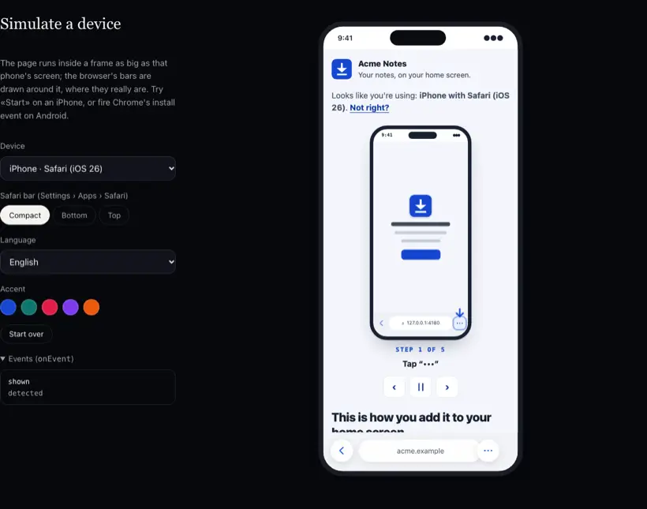

<h1 align="center">pwa-install-assistant</h1>

<p align="center"><strong>Get your web app onto the home screen. On every phone.</strong></p>

<p align="center">
  <a href="https://mauroz9.github.io/pwa-install-assistant/"></a>
</p>

<p align="center">
  <a href="https://mauroz9.github.io/pwa-install-assistant/"></a>
</p>

<p align="center">Simulate an iPhone, an iPad or an Android phone, or open it on yours: <em>the demo installs for real.</em><br><sub><a href="./README.es.md">Español</a> · <a href="#install">Install</a> · <a href="#usage">React · Vue · Svelte · Solid · Angular · HTML</a> · <a href="./docs/options.md">Options</a> · <a href="./docs/support.md">Support table</a></sub></p>

An install assistant for web apps. It works out which phone, browser and version someone is using, and walks them
through adding your app to the home screen **with the browser's real buttons**: an arrow on Safari's Share or
`•••` button, Chrome's own install dialog driven by a button on your page, or an illustrated guide for everything
else.

- **Every device.** iPhone and iPad (iOS 15 to 26, iPadOS posing as a Mac), Android with Chrome, Samsung Internet,
  Edge, Firefox, Opera, Brave and vendor browsers, in-app browsers (Instagram, Facebook, TikTok, WhatsApp, Gmail…),
  desktop (QR code) and «already installed». Tested against 67 real User-Agents.
- **An arrow on the real button.** On Safari it knows where Share or `•••` sits for each device, OS version,
  orientation and toolbar layout, measured on the iOS simulator.
- **Moves on by itself where it can.** On Chrome for Android it goes from your button to the native dialog to
  «Installed!» without a single «Next», retries if cancelled, and warns about the launcher's confirmation.
  Where the browser gives no signal (Safari), it says so and shows every step at once.
- **Nothing made up.** Each assisted flow is on only where it was verified on a simulator, an emulator or a device
  ([support table](./docs/support.md)); the rest falls back to the guide.
- **Any stack.** A framework-agnostic core with thin wrappers for **React** (and Next.js), **Vue**, **Svelte**,
  **Solid**, **Angular** and a **Web Component**. A headless state for your own UI.
- **Private and strict-CSP friendly.** Zero dependencies, zero network calls, no `innerHTML`, no inline styles: one
  `<style>` with your `nonce`. The QR code is generated locally.
- **Accessible.** WCAG 2.2 AA: every instruction in text (the arrow is a help), focus moved and announced on each
  step, real buttons, `prefers-reduced-motion` respected. Six languages.

## Install

```bash
npm i pwa-install-assistant
```

## Usage

### Vanilla JS / TypeScript

```ts
import { createInstallAssistant } from "pwa-install-assistant";

const assistant = createInstallAssistant(document.querySelector("#install"), {
  appName: "Acme",
  icon: "/icon-192.png",
  onEvent: (event) => analytics(event.type), // the library itself sends nothing
});

assistant.destroy();
```

Or as a bottom sheet that opens by itself after the first tap, once:

```ts
const sheet = createInstallAssistant(null, { appName: "Acme", mode: "sheet", trigger: "gesture" });
installButton.onclick = () => sheet.open();
```

> Chrome can fire `beforeinstallprompt` before your UI exists. The library starts listening as soon as it is
> imported; if you load the assistant lazily, import `captureInstallPrompt` from `pwa-install-assistant/headless`
> in your entry point and call it.

### React / Next.js

```tsx
import { InstallAssistant } from "pwa-install-assistant/react";

export function Install() {
  return <InstallAssistant appName="Acme" icon="/icon-192.png" onEvent={(e) => track(e.type)} />;
}
```

The React entry is a client component (`"use client"` is built in): render it straight from a Next.js server
component. With a strict CSP, pass the request's nonce: `<InstallAssistant nonce={nonce} />` (see
[`examples/next`](./examples/next), which sets the policy in `proxy.ts`). `ref.current.open()` opens a modal or
sheet. `useInstallState()` gives the headless state (`null` on the server).

### Vue 3 / Nuxt

```vue
<script setup>
import { InstallAssistant } from "pwa-install-assistant/vue";
</script>

<template>
  <InstallAssistant app-name="Acme" icon="/icon-192.png" @event="(e) => track(e.type)" />
</template>
```

It only touches the DOM once mounted: no `<ClientOnly>` needed in Nuxt.

### Svelte 4 / 5, SvelteKit

```svelte
<script>
  import { installAssistant } from "pwa-install-assistant/svelte";
</script>

<div use:installAssistant={{ appName: "Acme", icon: "/icon-192.png" }}></div>
```

### Solid

```tsx
import { installAssistant } from "pwa-install-assistant/solid";

<div use:installAssistant={{ appName: "Acme", icon: "/icon-192.png" }} />;
```

`createInstallState()` gives the headless state as a signal.

### Angular

Drop in the custom element (with `CUSTOM_ELEMENTS_SCHEMA`), or copy the typed standalone wrapper from
[`examples/angular/src/app/install-assistant.component.ts`](./examples/angular/src/app/install-assistant.component.ts).

```ts
import "pwa-install-assistant/element";
// template: <pwa-install-assistant app-name="Acme" icon="/icon-192.png"></pwa-install-assistant>
```

### Web Component (plain HTML, Astro, Rails, WordPress…)

```html
<pwa-install-assistant app-name="Acme" icon="/icon-192.png" locale="es"></pwa-install-assistant>

<script type="module">
  import "https://esm.sh/pwa-install-assistant/element";
  document.addEventListener("pwa-install", (e) => console.log(e.detail.type));
</script>
```

Attributes: `app-name`, `app-url`, `open-url`, `icon`, `locale`, `mode`, `trigger`, `accent`, `scheme`, `nonce`,
`debug`. Property `options` takes anything else; `open()` and `close()`. Light DOM: your CSS and the `--pia-*`
variables apply.

Working apps for each one in [`examples/`](./examples): Next, Nuxt, SvelteKit, Astro, Remix (React Router), Solid,
Angular and plain HTML.

## What each person sees

| Situation | What they get |
|---|---|
| **Chrome on Android** | The menu guide; when Chrome fires `beforeinstallprompt` (on a first visit, after some interaction and ~30–50 s), a four-step assistant appears on top: your button → Chrome's dialog → «Installing…» (with a note about the launcher's confirmation) → «Installed!» + «Open». Cancel → back to step 1 → «Try again». Installing from Chrome's menu also lands on «Installed!». |
| **Safari on iPhone/iPad (iOS 26)** | A looping animation of the whole sequence; one question about the Safari toolbar layout (iPhone only, with drawings, remembered); then **«Start»**: an arrow on the page edge pointing at the real `•••` or Share button and a hint pinned at the top with the next steps, readable above the Share sheet. |
| **Edge, Samsung Internet, Opera, Brave** | The illustrated guide; and if the browser fires `beforeinstallprompt`, a plain install button. |
| **Safari ≤ 18, Chrome/Edge/Firefox on iOS, Firefox and vendor browsers on Android** | The illustrated step-by-step guide for that browser, with «I can't see this option» tips. |
| **Instagram, Facebook, TikTok, WhatsApp, Gmail… (in-app browsers)** | «Open in Safari/Chrome» (`x-safari-https://` / Android intent), «Copy link», and the menu steps. |
| **iOS < 16.4 outside Safari** | Only Safari can do it: copy the link and open it there. |
| **Computer** | A QR code (generated locally) that opens the page on the phone. |
| **The installed app** | «It's already installed!» (`display-mode`, `navigator.standalone`, `getInstalledRelatedApps`, a local mark). |

Everyone can correct the detection with «Using another device or browser?».

### Why the arrow, and why it doesn't move on by itself on iOS

Safari has no install API and **tells the page nothing** when its Share sheet opens or closes (no `blur`, no
`visibilitychange`, no `visualViewport` change — checked on the iOS 26.3 simulator, see the
[support table](./docs/support.md)). And tapping the page closes the sheet, so there can be no «Next». The only
honest help is to point at the real button and keep the next steps pinned where they can be read. If a reliable
signal ever appears, `sheetSignal` is ready for it.

## Options

The most used; **every option is in [`docs/options.md`](./docs/options.md)**.

| Option | Default | |
|---|---|---|
| `appName`, `icon` | `document.title`, a letter | Shown in the texts and drawings. |
| `appUrl` / `openUrl` | this page / `appUrl` | URL for the QR code and «Copy link»; where «Open» goes. |
| `locale` | `"auto"` | `en` and `es` built in; `pt`, `fr`, `de`, `it` from `pwa-install-assistant/locales/*`. `messages` overrides any text. |
| `mode` | `"inline"` | `inline`, `modal` or `sheet` (native `<dialog>`). |
| `trigger`, `showAgainAfter`, `when` | manual, never again, not installed | When a modal/sheet opens by itself, and how often. |
| `theme` | — | `accent`, `success`, `radius`, `font`, `scheme` (`light`/`dark`/`auto`), any `--pia-*` variable. |
| `arrow` | `{ size: 44 }` | Size, colour, or draw it yourself. |
| `steps.illustrations` | `"default"` | `"minimal"` or your own drawing per step. |
| `support` | verified cases | Turn assisted flows on or off per guide. |
| `storage` | `"localStorage"` | `"none"`, `"sessionStorage"` or your adapter. Keys under `pwa-install.*`, never sent. |
| `qr` | `true` | `false` or your own `(url) => SVGElement`. |
| `nonce` | — | CSP nonce for the one injected `<style>`. |
| `debug` | `false` | Event log on screen and every implemented flow on, to test on a device. |
| `onEvent` | — | `detected`, `shown`, `prompt`, `accepted`, `dismissed`, `installed`, `opened-standalone`, `step`, `arrow-start`, `link-copied`… |

### Headless

```ts
import { createInstallController } from "pwa-install-assistant/headless"; // ~5 kB, no UI

const install = createInstallController();
install.subscribe((state) => render(state)); // state.view, state.prompt, state.phase, state.ios.spot…
button.onclick = () => install.prompt();
```

Also exported: `detectDevice()`, `chooseGuide()`, `isStandalone()`, `canPrompt()`, `promptInstall()`,
`whenInstalled()`, `openInBrowserUrl()`, the support table and the arrow positions.

## Size

min+gzip, first load: headless core **5.2 kB**; full UI with English and Spanish **31 kB** (+ 2.4 kB QR encoder,
loaded only on desktop); each extra language ~5 kB. Budgets are checked in CI.

## Browser support

The assistant runs in every evergreen browser and iOS Safari 15+. It uses `<dialog>` for the modal and sheet, and
`color-mix()` for derived theme colours. What each *case* gets is in the [support table](./docs/support.md).

## Development

```bash
npm install            # the library, the demo and every example (npm workspaces)
npm run build          # library → dist/
npm test               # unit tests (vitest)
npx playwright test    # end-to-end in Chromium against the demo, axe accessibility audit, strict CSP
npm run demo           # http://localhost:5173
npm run build:examples
```

Real Safari and Chrome: [`e2e/ios`](./e2e/ios) (XcodeGen + XCUITest on the iOS simulator) and
[`e2e/android`](./e2e/android) (emulator + adb + CDP). Results in [`docs/support.md`](./docs/support.md).

## Credits

Extracted from the installer of PlanABC. Alternatives looked at: `@khmyznikov/pwa-install` and
`pwa-add-to-homescreen`.

## License

[MIT](./LICENSE) © Mauro Serrano
