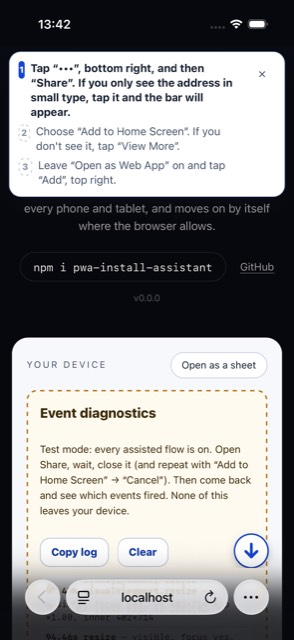
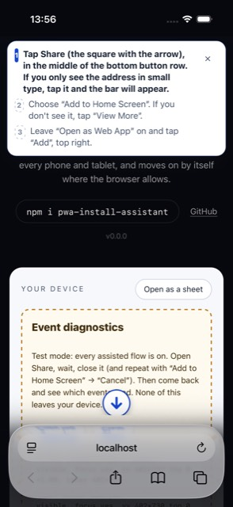
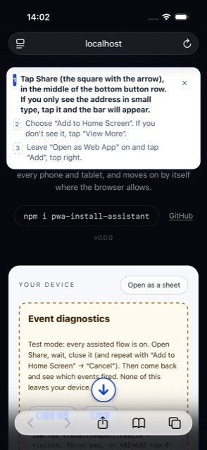
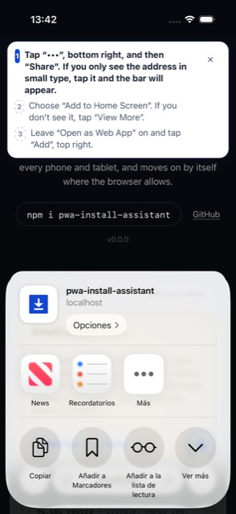
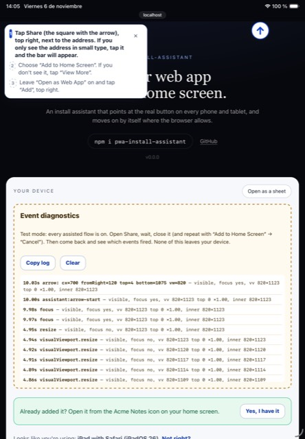
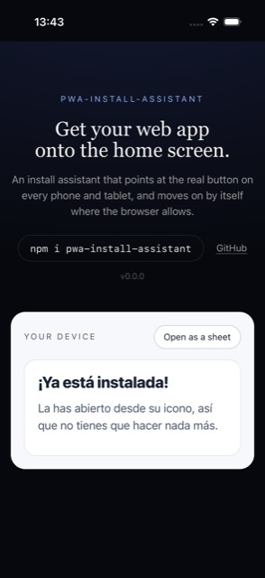
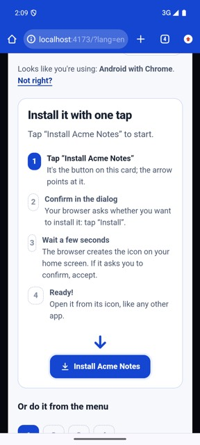
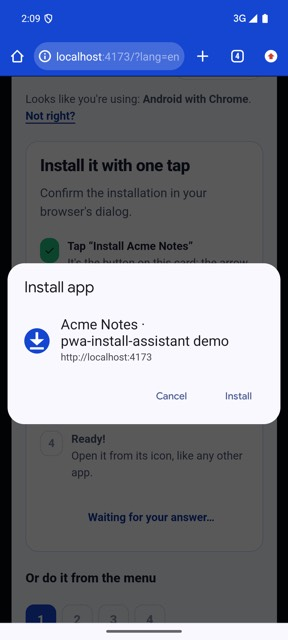
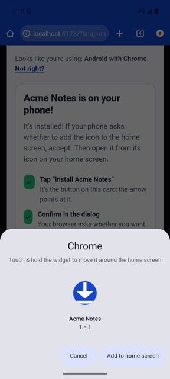
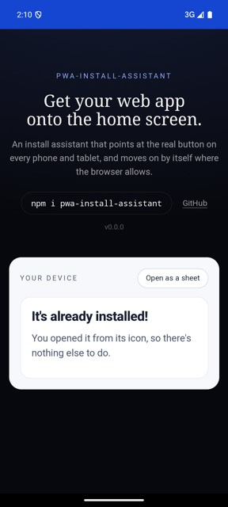

# Support table

What each case gets, and why. A case gets an **assisted flow** (Android prompt assistant or iOS arrow) only when it has
been verified on a simulator, an emulator or a real device; everything else gets the illustrated guide. The table in
code is `DEFAULT_SUPPORT` (`src/core/support.ts`) and the arrow positions are `ARROW_SPOTS` (`src/core/spots.ts`).

## Assisted flows

| Guide | Flow | Default | Verified on | Date |
|---|---|---|---|---|
| `android-chrome` | prompt assistant | **on** | Android emulator, Pixel 7, Android 15, Chrome 124 — reference, and **this library** (below) | 2026-11-06 |
| `android-edge`, `android-samsung`, `android-opera`, `android-brave` | prompt assistant | off | — (their plain install button still shows when the browser fires `beforeinstallprompt`) | |
| `iphone-safari-26` | iOS arrow, iOS ≥ 26 and < 27 | **on** | iOS 26.3 simulator, iPhone 17, XCUITest, toolbars Compact, Bottom and Top — reference, and **this library** (below) | 2026-11-06 |
| `ipad-safari-26` | iOS arrow, iPadOS ≥ 26 and < 27 | **on** | iOS 26.3 simulator, iPad A16, XCUITest, portrait and landscape — reference, and **this library** | 2026-11-06 |
| `iphone-safari`, `ipad-safari` (18 and older) | iOS arrow | off | — no simulator runtime | |
| Safari 27 | iOS arrow | off | — not released | |
| Every other guide | illustrated guide | — | | |

## Arrow positions (iOS 26.3 simulator)

| Device | Safari toolbar | Real button | Measured centre | Arrow |
|---|---|---|---|---|
| iPhone 17 (402×874 pt), portrait | Compact (default) | «•••», then Share | 58 pt from the right edge, bottom | bottom, `fromRight: 58` |
| iPhone 17, portrait | Bottom | Share, button row under the address | centre (x 200), bottom | bottom, 50 % |
| iPhone 17, portrait | Top | Share, bottom button row | centre (x 200), bottom | bottom, 50 % |
| iPhone 17, landscape | any | Share moves to the top bar (182 pt from the right on this model) | depends on the model | none, text only |
| iPad A16 (820×1180 pt), portrait and landscape | top bar | Share, right of the address | 120 pt from the right edge, top | top, `fromRight: 120` |

## This library on the iOS simulator (2026-11-06, v0.0.0)

Xcode 26.3, iOS 26.3 (23D8133) simulator, iPhone 17 (402×874 pt) and iPad A16 (820×1180 pt), Safari in Spanish (the
simulator follows the Mac). Harness: [`e2e/ios`](../e2e/ios) (XcodeGen + XCUITest driving Safari, Settings and
SpringBoard) on the demo with `debug: true`, served from the Mac. Each run: set the toolbar in Settings › Apps › Safari,
answer the page's question, «Start», open and close the sheet, open «Add to Home Screen» and cancel, open it again and
«Add» with «Open as Web App» on, open the icon from the Home Screen.

| Device | Safari toolbar | Real button (XCUITest centre) | Arrow (page, `getBoundingClientRect`) | Events while the sheet is open | Full flow → app mode → «It's already installed!» |
|---|---|---|---|---|---|
| iPhone 17 | Compact | «•••» x 344, 58 pt from the right, y 816 | x 344, 58 from the right, 4 px above the bottom edge | none (menu and sheet) | ✔ (`com.apple.webapp`, no address bar) |
| iPhone 17 | Bottom | Share x 200, y 824 | x 201, centred | none | ✔ |
| iPhone 17 | Top | Share x 200, y 822 (floating bottom bar) | x 201, centred, above the bar (safe area 34 + 4 px) | none | ✔ |
| iPad A16, portrait | top bar | Share x 700, 120 pt from the right, y 54 | x 700, 120 from the right, 4 px below the top | none | ✔ |
| iPad A16, landscape | top bar | Share 120 pt from the right (window 1180) | positioned from the right: same 120 | — | — |

- «Add to Home Screen» dialog: `blur` + `visualViewport.resize`; cancelling it: `visualViewport.resize`, then `focus`.
  Confirms `sheetSignal: null`.
- On iPad the bar was collapsed after «Start» (portrait and landscape); tapping the address expands it, as the hint says.
- The app launched from the icon has no `?lang`, so it shows Spanish (the device language).

## This library on the Android emulator (2026-11-06, v0.0.0)

AVD Pixel 7, 3 GB RAM, `android-35;google_apis_playstore;arm64-v8a` (Android 15), Chrome 124.0.6367.219 (the image's,
not updated). Harness: [`e2e/android/run.mjs`](../e2e/android/run.mjs): `adb reverse` to the demo on the Mac, real taps
with `adb shell input` on buttons found with uiautomator, page state read over CDP; nothing injected.

| Check | Result |
|---|---|
| Installable (`Page.getInstallabilityErrors`) | ✔ none |
| Before `beforeinstallprompt`: the menu guide | ✔ «Tap the ⋮ menu» |
| `beforeinstallprompt` on a first visit | ✔ arrived **46 s** after opening, while scrolling; the assistant appeared on top of the guide |
| «Install Acme Notes» → Chrome's own install sheet | ✔ phase `prompting` |
| Cancel → back to step 1 → Chrome offers it again → «Try again» | ✔ |
| Retry → «Install» → `accepted` with the launcher hint | ✔ |
| Launcher confirmation **after** `appinstalled` (no WebAPK on localhost) | ✔ «Add to home screen» sheet shown with the hint visible behind it; accepted |
| `appinstalled` → «Acme Notes is on your phone!», by itself | ✔ |
| Icon on the launcher → opens as an app (`display-mode: standalone`, no browser UI) → «It's already installed!» | ✔ |

Not tested (no official APK on the emulator): Samsung Internet, Firefox, Edge, Opera and Brave. Their assisted flow
stays off; their plain install button still appears if they fire `beforeinstallprompt`.

### Screenshots

| | | | |
|---|---|---|---|
|  |  |  |  |
| iPhone, Compact | iPhone, Bottom | iPhone, Top | Share sheet + pinned hint |
|  |  |  |  |
| iPad | iOS app mode | Android assistant | Chrome's own dialog |
|  |  | | |
| Launcher confirmation | Android app mode | | |

## Facts the design relies on

- **iOS has no install API and no reliable event** when the Share sheet opens or closes (`blur`, `visibilitychange`,
  `pagehide` and `visualViewport` stay silent). Only the «Add to Home Screen» dialog fires `blur`. So the iOS hint never
  moves on by itself (`sheetSignal: null`), and there is no «Next» on the page (tapping it closes the sheet).
- The Share sheet opens at half height: a hint pinned at the top stays readable until «View More» expands it.
- Scrolling collapses Safari's bar; the assistant scrolls to the top on «Start» and the hint says to tap the address.
- `beforeinstallprompt` does **not** fire on load on a first visit (it came after interaction and ~30 s on the page in
  the emulator). Until then the menu guide shows; the assistant appears when it arrives.
- Dismissing the native dialog makes Chrome fire `beforeinstallprompt` again: back to step 1 with «Try again».
- Without a WebAPK (e.g. localhost) Chrome makes a shortcut and the **launcher asks to confirm after `appinstalled`**;
  the assistant says to accept it.
- Success on iOS is only detectable once the icon is opened (`navigator.standalone`, `display-mode: standalone`).

## Pending verification

- Safari 17/18 on iPhone and iPad (the `legacy` rows of `ARROW_SPOTS`).
- Samsung Internet, Firefox, Edge, Opera and Brave on Android; a real WebAPK; `getInstalledRelatedApps`; a real device.
- **Browser labels in Portuguese, French, German and Italian** (`browser.*` in those packs): written from the browsers'
  usual wording, not yet checked on a device in each language. English and Spanish follow the reference.

Test on a device without changing the table: `debug: true` turns every implemented flow on and logs page events.
